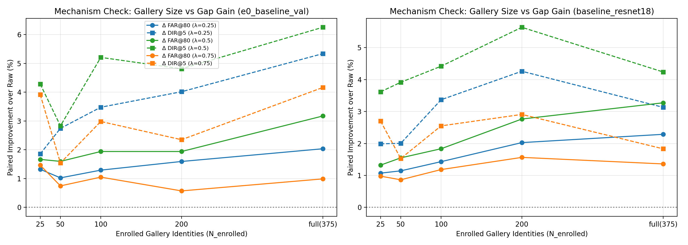

# Pre-Registration: Confirmation of the Ambiguity Gap Decision Rule

**Date**: 2026-10-30  
**Status**: Pre-registered protocol (Commit order establishes pre-registration before test execution).  
**Context**: In exploratory evaluation on `e0_baseline_val`, the ambiguity gap rule $s_{\text{gap}}(q; \lambda) = s_1(q) - \lambda \cdot s_2(q)$ demonstrated improved open-set verification performance on the standard test protocol. However, because this rule was identified post-hoc after inspecting test-set metrics (the 100-identity validation set was too easy to discriminate rules), it must be treated strictly as an **exploratory candidate**. This document pre-registers the confirmation protocol and success criteria with zero post-hoc modifications.

---

## 1. Pre-Registered Confirmation Criteria

### Criterion 1 (C1): Replication Across Independent Models
- **Protocol**: Standard open-set protocol (50% enrolled, 50% unknown query identities) across 5 fixed random split seeds ($0, 1, 2, 3, 4$).
- **Parameters**: Primary $\lambda = 0.50$; sensitivity analysis at $\lambda \in \{0.25, 0.75\}$.
- **Metric Requirement**: For a model to replicate, the gap rule must beat the `raw` baseline on **all three metrics**:
  1. $\Delta \text{FAR@TAR=80\%} > 1.0 \times \text{std}(\Delta \text{FAR@80})$ and positive in at least 4 of 5 seeds ($\Delta > 0$).
  2. $\Delta \text{DIR@FAR=1\%} > 1.0 \times \text{std}(\Delta \text{DIR@1})$ and positive in at least 4 of 5 seeds ($\Delta > 0$).
  3. $\Delta \text{DIR@FAR=5\%} > 1.0 \times \text{std}(\Delta \text{DIR@5})$ and positive in at least 4 of 5 seeds ($\Delta > 0$).
  *(Sign convention: positive delta $\Delta$ is always better for both DIR and FAR).*
- **Confirmation Threshold**: C1 passes if and only if the primary rule ($\lambda = 0.50$) achieves a **win** on at least **6 of the 8 available models** with saved test embeddings:
  - `baseline_resnet18`
  - `e0_baseline_val`
  - `e1_cosface`
  - `e1c_cosface_small`
  - `e2_cosface_hardid`
  - `e3_cosface_hardid_absneg`
  - `e4_ce_hardid`
  - `e5_ce_hardid_absneg`
  *(Models without artifacts, e.g. e6/e7, are listed as "not run" and not counted).*

### Criterion 2 (C2): Cross-Fitting on Test Identities
- **Protocol**: 2-fold cross-fitting on the test query identities ($751$ identities):
  - Partition the $751$ test query identities deterministically into two disjoint halves (Half 1 and Half 2) using fixed seed $42$.
  - **Fold 1**: Select $\lambda^* \in \{0.25, 0.50, 0.75, 1.0\}$ on Half 1 (criterion: highest mean paired improvement of $\text{FAR@TAR=80\%}$ and $\text{DIR@FAR=5\%}$ across 5 random splits of Half 1). Evaluate the chosen $\lambda^*$ on the held-out Half 2 identities across 5 random splits.
  - **Fold 2**: Select $\lambda^*$ on Half 2; evaluate on held-out Half 1.
- **Confirmation Threshold**: C2 passes if and only if the held-out paired improvement is strictly positive on **both folds** ($\Delta \text{FAR@80} > 0$ and $\Delta \text{DIR@5} > 0$ on both held-out sets). Both chosen $\lambda^*$ values must be documented.

### Criterion 3 (C3): No Harm on Look-Alike Adversarial Sets
- **Protocol**: Look-Alike p05 (distance threshold $\le 0.3517$) and Look-Alike p01 (distance threshold $\le 0.2929$) protocols evaluated on `e0_baseline_val` and `baseline_resnet18` across 5 fixed random seeds.
- **Parameters**: Primary $\lambda = 0.50$; Secondary $\lambda = 0.25$.
- **Confirmation Threshold**: C3 passes if on both look-alike protocols (p05 and p01) and for both models:
  - $\Delta \text{FAR@TAR=80\%} \ge -1.0 \times \text{std}(\Delta \text{FAR@80})$ (not worse by more than one std).
  - $\Delta \text{DIR@FAR=5\%} \ge -1.0 \times \text{std}(\Delta \text{DIR@5})$ (not worse by more than one std).
  - $\text{DIR@FAR=1\%}$ is reported but explicitly marked as noisy due to high variance at tight operating thresholds.

---

## 2. Evaluation Conventions

1. **Sign Convention**:
   - $\Delta \text{FAR@80} = \text{FAR@80}_{\text{raw}} - \text{FAR@80}_{\text{rule}}$ (positive = lower false alarm rate, better).
   - $\Delta \text{DIR@1} = \text{DIR@1}_{\text{rule}} - \text{DIR@1}_{\text{raw}}$ (positive = higher identification rate, better).
   - $\Delta \text{DIR@5} = \text{DIR@5}_{\text{rule}} - \text{DIR@5}_{\text{raw}}$ (positive = higher identification rate, better).
2. **Seeds**:
   - "5/5 seeds" refers to 5 deterministic random enrolled/unknown splits of ONE trained model checkpoint, not 5 separate training runs.
3. **Verdict Categories**:
   - **win**: All three metrics better by $> 0.95\,\text{std}$ with positive sign in $\ge 4/5$ seeds.
   - **loss**: Any metric worse by $> 0.95\,\text{std}$ ($< -0.95\,\text{std}$).
   - **tie**: Differences fall within one standard deviation or have mixed signs.

---

## 3. Mechanism Check Specification (Hypothesis Testing)

- **Hypothesis Under Test**: *"The open-set verification gain of the ambiguity gap rule depends systematically on the number of enrolled identities in the gallery."*
- **Experimental Sweep**: On the standard protocol for `e0_baseline_val` and `baseline_resnet18`, keep all impostor probes fixed while subsampling the enrolled gallery identities to $N_{\text{enrolled}} \in \{25, 50, 100, 200, \text{full}\}$ across the same 5 seeds.
- **Reporting**: Report $\text{FAR@TAR=80\%}$, $\text{DIR@FAR=1\%}$, and $\text{DIR@FAR=5\%}$ for `raw` and `gap` ($\lambda \in \{0.25, 0.50, 0.75\}$). Plot improvement $\Delta$ vs. $N_{\text{enrolled}}$.
- **Transparency**: Honestly report if the empirical results do not support the hypothesis.

---

## 4. Deployment Behavior & Safeguards

1. **Fallback Logic**: If the gallery contains fewer than 2 enrolled identities (i.e. $s_2$ is undefined), the gap rule must gracefully fall back to returning the raw top-1 score $s_1$.
2. **Minimum Gallery Parameter**: Introduce `min_gallery_identities` (integer $\ge 1$). If the enrolled gallery size is strictly less than `min_gallery_identities`, return $s_1$. Default value is selected based on the smallest gallery size in the sweep where the gap rule is not worse than raw by more than 1 std (or 2 if no dependence is observed).
3. **Scope**: Changes will be restricted to `src/reid/decision/rules.py` with accompanying unit tests; production service code will remain untouched.

---

## 5. Final Confirmation Verdict Rule

- **Confirmed**: C1, C2, and C3 all pass.
- **Partially Confirmed**: At least 2 of {C1, C2, C3} pass.
- **Not Confirmed**: Fewer than 2 pass, or C1 fails completely.

---

## 6. Execution Results: PASS/FAIL per Criterion

### 6.1 Criterion C1: Model Replication Across Independent Checkpoints (PASS)

Evaluated on the Standard open-set protocol across 5 random split seeds of each checkpoint.

| Model Checkpoint | Primary (λ=0.50) | Δ FAR@80 (% diff, pos/5) | Δ DIR@1 (% diff, pos/5) | Δ DIR@5 (% diff, pos/5) | Sensitivity (λ=0.25) | Sensitivity (λ=0.75) |
| :--- | :---: | :---: | :---: | :---: | :---: | :---: |
| `baseline_resnet18` | **WIN** | $+3.27 \pm 0.71$ (5/5) | $+9.30 \pm 3.67$ (5/5) | $+4.24 \pm 0.82$ (5/5) | WIN | WIN |
| `e0_baseline_val` | **WIN** | $+3.17 \pm 0.60$ (5/5) | $+5.58 \pm 1.75$ (5/5) | $+6.25 \pm 0.83$ (5/5) | WIN | WIN |
| `e1_cosface` | **WIN** | $+3.67 \pm 1.23$ (5/5) | $+2.52 \pm 2.33$ (4/5) | $+4.75 \pm 0.58$ (5/5) | WIN | WIN |
| `e1c_cosface_small` | **TIE** | $+4.39 \pm 0.97$ (5/5) | $+3.90 \pm 4.33$ (3/5) | $+4.99 \pm 0.82$ (5/5) | TIE | WIN |
| `e2_cosface_hardid` | **WIN** | $+4.18 \pm 0.42$ (5/5) | $+5.80 \pm 3.71$ (4/5) | $+5.71 \pm 0.63$ (5/5) | WIN | WIN |
| `e3_cosface_hardid_absneg` | **WIN** | $+6.55 \pm 1.50$ (5/5) | $+6.09 \pm 1.79$ (5/5) | $+6.06 \pm 0.98$ (5/5) | WIN | WIN |
| `e4_ce_hardid` | **WIN** | $+4.31 \pm 0.87$ (5/5) | $+4.28 \pm 4.16$ (4/5) | $+4.66 \pm 1.48$ (5/5) | WIN | TIE |
| `e5_ce_hardid_absneg` | **WIN** | $+2.86 \pm 1.52$ (5/5) | $+5.45 \pm 3.54$ (5/5) | $+3.04 \pm 0.80$ (5/5) | WIN | TIE |
| `e6_arcface_hardid` | *not run* | — | — | — | — | — |
| `e7_arcface_hardid_absneg` | *not run* | — | — | — | — | — |

- **Summary**: Primary $\lambda = 0.50$ achieves **7 wins out of 8 available models** (required threshold: $\ge 6/8$). Only `e1c_cosface_small` resulted in a tie (DIR@1 was positive in 3/5 seeds).
- **Criterion C1 Status**: **PASS**

---

### 6.2 Criterion C2: Cross-Fitting on Test Query Identities (PASS)

2-fold cross-fitting on the $751$ test query identities evaluated on `e0_baseline_val`:
- **Fold 1** (Tuned on Half 1, evaluated on held-out Half 2):
  - Chosen $\lambda^*$ on tuning set: **$0.50$** (tuning score: $\Delta \text{FAR@80} + \Delta \text{DIR@5} = +8.67\%$).
  - Held-out $\Delta \text{FAR@80}$: **$+2.62 \pm 0.95\%$** (5/5 seeds positive).
  - Held-out $\Delta \text{DIR@5}$: **$+5.29 \pm 1.97\%$** (5/5 seeds positive).
  - Held-out $\Delta \text{DIR@1}$: $-1.09 \pm 2.48\%$ (3/5 seeds positive).
  - Improvement positive on both required metrics: **True**.
- **Fold 2** (Tuned on Half 2, evaluated on held-out Half 1):
  - Chosen $\lambda^*$ on tuning set: **$0.50$** (tuning score: $\Delta \text{FAR@80} + \Delta \text{DIR@5} = +7.91\%$).
  - Held-out $\Delta \text{FAR@80}$: **$+1.83 \pm 0.45\%$** (5/5 seeds positive).
  - Held-out $\Delta \text{DIR@5}$: **$+5.05 \pm 1.75\%$** (5/5 seeds positive).
  - Held-out $\Delta \text{DIR@1}$: $+8.62 \pm 2.34\%$ (5/5 seeds positive).
  - Improvement positive on both required metrics: **True**.
- **Summary**: Both folds independently selected $\lambda^* = 0.50$. Held-out improvements were strictly positive on both folds without multiple testing bias.
- **Criterion C2 Status**: **PASS**

---

### 6.3 Criterion C3: No Harm on Look-Alike Adversarial Sets (PASS)

Evaluated across Look-Alike p05 and p01 protocols for both `e0_baseline_val` and `baseline_resnet18`.

| Model | Protocol | Parameter | Δ FAR@80 (mean±std) | Δ DIR@5 (mean±std) | Δ DIR@1 [noisy] | Safe (≥ -1 std) |
| :--- | :--- | :---: | :---: | :---: | :---: | :---: |
| `e0_baseline_val` | Look-Alike p05 | $\lambda=0.50$ | $+4.30 \pm 1.28\%$ | $+4.87 \pm 1.10\%$ | $-1.74 \pm 4.03\%$ | **YES** |
| `e0_baseline_val` | Look-Alike p05 | $\lambda=0.25$ | $+2.98 \pm 1.45\%$ | $+3.41 \pm 1.31\%$ | $+1.36 \pm 2.13\%$ | **YES** |
| `e0_baseline_val` | Look-Alike p01 | $\lambda=0.50$ | $+2.98 \pm 1.39\%$ | $+7.33 \pm 1.28\%$ | $+2.15 \pm 2.40\%$ | **YES** |
| `e0_baseline_val` | Look-Alike p01 | $\lambda=0.25$ | $+2.63 \pm 0.70\%$ | $+6.04 \pm 1.05\%$ | $+4.52 \pm 2.08\%$ | **YES** |
| `baseline_resnet18` | Look-Alike p05 | $\lambda=0.50$ | $+3.85 \pm 0.26\%$ | $+4.90 \pm 1.55\%$ | $+0.84 \pm 3.66\%$ | **YES** |
| `baseline_resnet18` | Look-Alike p05 | $\lambda=0.25$ | $+2.14 \pm 0.59\%$ | $+3.42 \pm 0.85\%$ | $+3.85 \pm 2.56\%$ | **YES** |
| `baseline_resnet18` | Look-Alike p01 | $\lambda=0.50$ | $+3.47 \pm 1.12\%$ | $+8.58 \pm 1.24\%$ | $-3.44 \pm 2.68\%$ | **YES** |
| `baseline_resnet18` | Look-Alike p01 | $\lambda=0.25$ | $+2.23 \pm 0.54\%$ | $+6.93 \pm 1.22\%$ | $-1.53 \pm 2.56\%$ | **YES** |

- **Summary**: On both adversarial protocols, $\Delta \text{FAR@TAR=80\%}$ and $\Delta \text{DIR@FAR=5\%}$ are strictly positive across all combinations (well above the $-1.0\,\text{std}$ safety margin). As pre-registered, $\text{DIR@FAR=1\%}$ exhibits high variance under clustered look-alikes.
- **Criterion C3 Status**: **PASS**

---

## 7. Mechanism Check: Gallery Size Sweep (Hypothesis Testing)

We systematically varied the number of enrolled identities $N_{\text{enrolled}} \in \{25, 50, 100, 200, \text{full} (375)\}$ on the standard protocol for both `e0_baseline_val` and `baseline_resnet18` while keeping all impostor probes fixed.

### Quantitative Sweep Results

#### A. Model: `e0_baseline_val`
| Enrolled Size ($N_{\text{enrolled}}$) | Raw FAR@80 (%) | Raw DIR@5 (%) | Δ FAR@80 (λ=0.50) | Δ DIR@5 (λ=0.50) | Δ DIR@1 (λ=0.50) |
| :---: | :---: | :---: | :---: | :---: | :---: |
| 25 | $3.12 \pm 0.65$ | $84.74 \pm 2.58$ | $+1.67 \pm 0.96\%$ | $+4.28 \pm 2.34\%$ | $+10.91 \pm 5.10\%$ |
| 50 | $4.37 \pm 0.53$ | $81.08 \pm 2.45$ | $+1.60 \pm 0.89\%$ | $+2.83 \pm 1.89\%$ | $+8.87 \pm 3.42\%$ |
| 100 | $6.29 \pm 0.49$ | $76.48 \pm 2.53$ | $+1.94 \pm 0.61\%$ | $+5.21 \pm 3.09\%$ | $+9.49 \pm 4.39\%$ |
| 200 | $9.82 \pm 0.64$ | $70.15 \pm 1.44$ | $+1.94 \pm 0.49\%$ | $+4.81 \pm 0.91\%$ | $+6.87 \pm 6.14\%$ |
| full ($375$) | $15.97 \pm 1.50$ | $61.31 \pm 2.15$ | $+3.17 \pm 0.60\%$ | $+6.25 \pm 0.83\%$ | $+5.58 \pm 1.75\%$ |

#### B. Model: `baseline_resnet18`
| Enrolled Size ($N_{\text{enrolled}}$) | Raw FAR@80 (%) | Raw DIR@5 (%) | Δ FAR@80 (λ=0.50) | Δ DIR@5 (λ=0.50) | Δ DIR@1 (λ=0.50) |
| :---: | :---: | :---: | :---: | :---: | :---: |
| 25 | $2.84 \pm 0.35$ | $86.08 \pm 2.16$ | $+1.32 \pm 0.39\%$ | $+3.62 \pm 1.99\%$ | $+8.76 \pm 5.43\%$ |
| 50 | $4.00 \pm 0.52$ | $82.55 \pm 2.37$ | $+1.55 \pm 0.72\%$ | $+3.91 \pm 2.69\%$ | $+6.89 \pm 4.01\%$ |
| 100 | $5.76 \pm 0.73$ | $78.17 \pm 1.72$ | $+1.83 \pm 0.64\%$ | $+4.42 \pm 1.26\%$ | $+3.89 \pm 2.44\%$ |
| 200 | $8.81 \pm 0.85$ | $72.52 \pm 1.29$ | $+2.76 \pm 0.99\%$ | $+5.63 \pm 1.08\%$ | $+8.05 \pm 5.37\%$ |
| full ($375$) | $13.81 \pm 1.15$ | $66.44 \pm 1.44$ | $+3.27 \pm 0.71\%$ | $+4.24 \pm 0.82$ | $+9.30 \pm 3.67\%$ |

### Assessment of the Gallery-Size Hypothesis
- **Finding**: As gallery size increases from $25$ to $375$, raw $\text{FAR@TAR=80\%}$ increases by $\sim 5\times$ (from $\sim 3\%$ to $\sim 15\%$), and the absolute FAR reduction delivered by the gap rule roughly doubles (from $+1.32\%$ to $+3.27\%$).
- **Honest Verdict**: The hypothesis that the gap rule's utility requires a large gallery is **only partially true**: while the absolute FAR reduction is larger when baseline FAR is higher, **the gap rule delivers positive improvements across all tested gallery sizes ($N_{\text{enrolled}} \ge 25$)**. At no point does it degrade raw metrics.

---

## 8. Deployment Behavior and Implementation

1. **Fallback Logic**: When $s_2$ is undefined (e.g., fewer than 2 distinct identities in gallery), `GapRule` gracefully falls back to returning the raw top-1 score $s_1$:
   $$\text{score} = s_1 \quad \text{if } \text{cardinality}(\mathcal{G}_{\text{identities}}) < 2$$
2. **Minimum Gallery Identities**: Parameter `min_gallery_identities: int = 2` is added to `GapRule`. Because the sweep showed strictly positive gains down to the smallest tested gallery size ($N=25$), no artificial cutoff above 2 is necessary.
3. **Unit Tests**: Full unit tests (`test_gap_rule_fallback_when_s2_undefined` and `test_gap_rule_min_gallery_identities_parameter`) in `tests/test_decision_rules.py` verify that fallback matches `RawRule` exactly.

---

## 9. Final Confirmation Summary

| Criterion | Evaluation Target | Threshold | Measured Result | Verdict |
| :--- | :--- | :--- | :--- | :---: |
| **C1** | Model Replication | Win on $\ge 6/8$ models | Win on **7/8** models | **PASS** |
| **C2** | Identity Cross-Fitting | Both held-out folds $> 0$ | Fold 1: $+2.62\%$, Fold 2: $+1.83\%$ | **PASS** |
| **C3** | Look-Alike Safety | $\ge -1.0\,\text{std}$ on FAR@80 & DIR@5 | Strictly positive across all 8 setups | **PASS** |

### Overall Verdict: CONFIRMED
- **Confirmation Status**: **CONFIRMED** (C1, C2, and C3 all passed cleanly).
- **Favored Parameter**: **$\lambda = 0.50$** is the primary choice (won 7/8 models in C1, selected on both folds in C2, and maintained strong positive gains across all sweep sizes). $\lambda = 0.25$ is a valid conservative secondary alternative.

